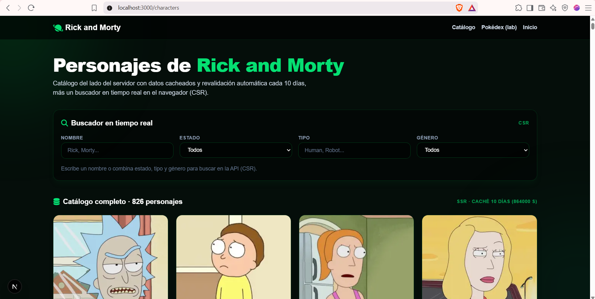
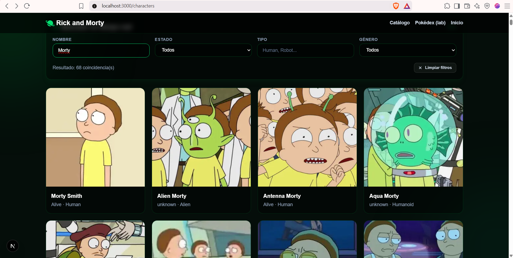
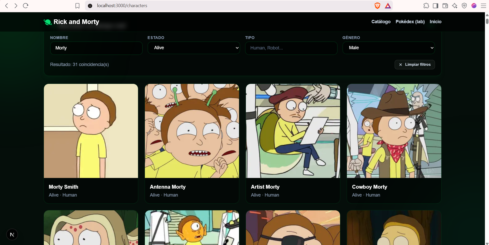
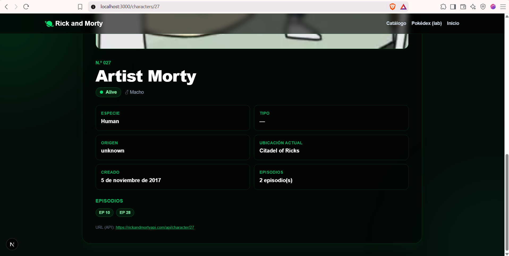
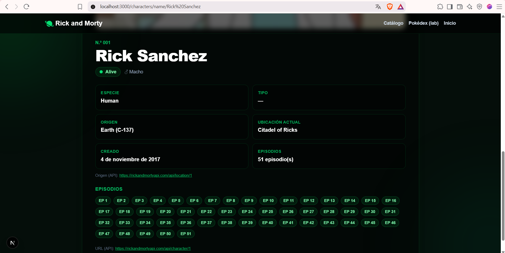
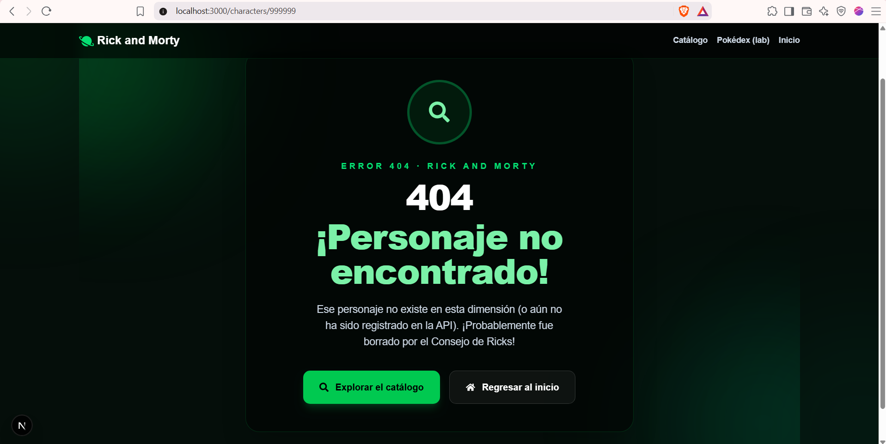
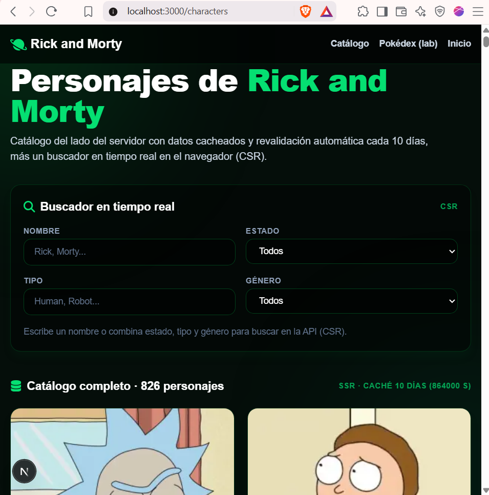
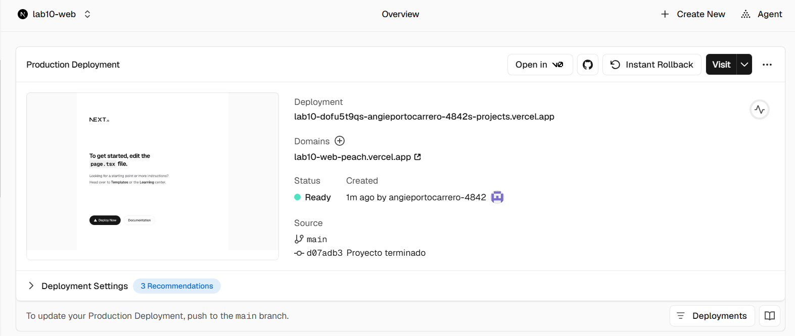

# Laboratorio Next.js: Rick and Morty API

Repositorio de laboratorio de **Next.js 16.4.3** con dos aplicaciones académicas:

1. **Pokédex (SSG + ISR)** — laboratorio anterior de rutas estáticas con la PokeAPI, conservado intacto.
2. **Rick and Morty** — laboratorio actual de rutas estáticas y dinámicas con la [Rick and Morty API](https://rickandmortyapi.com/documentation/#character), disponible en **`/characters`**.

La página principal original (`/`) y todo el laboratorio de Pokémon (`/pokemon`, `/pokemon/[name]`) se conservaron sin cambios; la funcionalidad nueva se agregó de forma independiente bajo `/characters`.

**Objetivo del laboratorio:** demostrar, sobre una única aplicación, el uso correcto de **SSR, SSG, ISR y CSR** consumiendo una API externa, con `generateStaticParams`, caché de datos con revalidación, rutas dinámicas bajo demanda y un buscador interactivo en el navegador.

## Funcionalidades principales

- Catálogo completo de **826 personajes** renderizado desde el servidor.
- Buscador en tiempo real por **nombre, estado (status), tipo (type) y género (gender)**, con filtros combinables (CSR).
- Tarjetas con imagen, estado, especie, tipo y género.
- Fichas de detalle **por ID** (`/characters/1`) y **por nombre** (`/characters/name/Rick%20Sanchez`).
- Todos los campos de la API en el detalle: `id`, `name`, `status`, `species`, `type`, `gender`, `origin`, `location`, `image`, `episode`, `url` y `created`.
- Imágenes con **lazy loading** mediante `next/image`.
- Manejo de errores de red, resultados vacíos y personajes inexistentes con `notFound()` y páginas 404 personalizadas.
- Diseño **responsive** con tema oscuro de ciencia ficción y detalles verdes (Tailwind CSS 4).

## Tecnologías

| Tecnología | Versión / detalle |
| --- | --- |
| [Next.js](https://nextjs.org/docs) | 16.4.3 (App Router, Turbopack) |
| React | 19.3.0 |
| TypeScript | 5.x |
| Tailwind CSS | 4.x (integración con Turbopack) |
| [Rick and Morty API](https://rickandmortyapi.com/documentation/#character) | REST pública, sin autenticación |
| react-icons | 5.x (iconos de la interfaz) |

Configuración relevante de `next.config.ts`:

```ts
const nextConfig: NextConfig = {
  cacheComponents: true,
  partialPrefetching: true,
  images: {
    remotePatterns: [
      { protocol: "https", hostname: "raw.githubusercontent.com" }, // PokeAPI
      { protocol: "https", hostname: "rickandmortyapi.com" },       // Rick and Morty
    ],
  },
};
```

## Estructura del proyecto

```
src/
├── app/
│   ├── page.tsx                  # Página principal original (intacta)
│   ├── not-found.tsx             # 404 global
│   ├── pokemon/                  # Laboratorio anterior (Pokédex) — intacto
│   │   ├── page.tsx              #   Lista SSR/SSG (151 Pokémon)
│   │   ├── [name]/page.tsx       #   Detalle SSG + ISR (revalidate 1d)
│   │   ├── layout.tsx / error.tsx / not-found.tsx
│   └── characters/               # Laboratorio actual (Rick and Morty)
│       ├── layout.tsx            #   Layout oscuro verde + metadata
│       ├── page.tsx              #   Catálogo 826 (SSR) + buscador CSR
│       ├── [id]/page.tsx         #   Detalle por ID (SSG parcial + demanda)
│       ├── name/[name]/page.tsx  #   Detalle por nombre (SSG parcial + demanda)
│       ├── error.tsx / not-found.tsx
├── components/characters/        # Card, Grid, Detail, Skeleton, Search (CSR)
├── lib/rick-and-morty/api.ts     # Capa de datos "use cache" (por función) + cacheLife
└── types/character.ts            # Tipos TypeScript de la API
```

---

## 1. Laboratorio anterior: Pokédex (conservado)

El laboratorio de Pokémon sigue funcionando igual, con la PokeAPI:

| Ruta | Estrategia |
| --- | --- |
| `/pokemon` | Lista de los primeros 151 Pokémon, datos con `revalidate: 86400` (1 día) |
| `/pokemon/[name]` | `generateStaticParams` con los 151 nombres (SSG) + ISR con revalidación diaria |
| `/pokemon/pokemon-inventado-123` | 404 personalizada del segmento |
| `/una-ruta-inexistente` | 404 global (`src/app/not-found.tsx`) |

Detalle del Pokémon (nombre, número, artwork, tipos con colores, estadísticas, altura, peso y habilidades) en `src/app/pokemon/[name]/page.tsx`, con `fetch` cacheado, `notFound()` en 404 y `<Suspense>` con skeleton.

---

## 2. Funcionalidades implementadas (Rick and Morty)

- **Catálogo completo:** los **826 personajes** de la API se obtienen recorriendo su paginación (42 páginas de 20) y se renderizan en el servidor en `/characters`.
- **Búsqueda en tiempo real (CSR):** el componente `CharacterSearch` (`'use client'`) consulta la API directamente desde el navegador combinando `name`, `status`, `type` y `gender` vía `URLSearchParams`, con debounce de 350 ms y `AbortController` para cancelar peticiones obsoletas. Gestiona estados de carga, error, resultados vacíos y botón de limpiar filtros.
- **Tarjetas:** imagen, nombre, número, badge de estado con punto de color (Alive / Dead / unknown), especie, tipo y género; enlace a la ficha de detalle.
- **Detalle por ID y por nombre:** ambas rutas comparten el componente `CharacterDetail`.
- **Todos los campos de la API:** incluidos origen, ubicación actual, episodios (badges enlazados a cada URL de episodio), URL del recurso y fecha de creación formateada.
- **Lazy loading:** todas las imágenes usan `next/image` con `loading="lazy"` y `fill` + `sizes` adecuados por breakpoint.
- **Errores y 404:** fallos de red → `error.tsx` del segmento con reintento; personajes inexistentes → `notFound()` → `not-found.tsx` con enlaces para regresar al catálogo.
- **Diseño responsive:** tema oscuro de ciencia ficción con acentos verdes, glows difuminados y rejilla de 1/2/3/4 columnas según el viewport.

---

## 3. Rutas

| Ruta | Tipo | Descripción |
| --- | --- | --- |
| `/` | Estática | Página principal original del proyecto (intacta) |
| `/pokemon` | Estática | Laboratorio anterior: lista de Pokémon |
| `/characters` | Estática (SSR/ISR) | Catálogo completo de 826 personajes + buscador CSR |
| `/characters/1` | Estática (SSG) | Detalle de Rick Sanchez, generada con `generateStaticParams` |
| `/characters/500` | Dinámica bajo demanda | Ejemplo de ID no incluido en el build: se resuelve en el primer acceso y queda cacheada (ISR) |
| `/characters/name/Rick%20Sanchez` | Estática (SSG) | Detalle por nombre (el nombre llega URL-encoded y se decodifica) |
| `/characters/999999` | Bajo demanda | Personaje inexistente: muestra la 404 personalizada «¡Personaje no encontrado!» con enlace al catálogo |

El proyecto **genera estáticamente una selección de rutas** con `generateStaticParams` —los primeros 10 IDs y sus nombres únicos, tomados de la primera página de la API— y **permite resolver las demás bajo demanda**: al visitar un ID o nombre no incluido, Next.js sirve el App Shell, genera la página en background y la cachea (ISR con Cache Components), de modo que las visitas siguientes se sirven completas.

---

## 4. Conceptos técnicos

La aplicación implementa las cuatro estrategias de renderizado de forma distinguible:

### SSR (Server-Side Rendering)

El catálogo de `/characters` se obtiene y renderiza **en el servidor**: el HTML de los 826 personajes viaja ya resuelto al navegador; el cliente solo hidrata. La búsqueda, en cambio, sí es CSR (ver abajo).

### SSG (Static Site Generation)

Durante `next build`, Next.js ejecuta `generateStaticParams` y genera páginas HTML estáticas para:

- `/characters` (catálogo completo),
- `/characters/1` … `/characters/10`,
- `/characters/name/<nombre>` de esos 10 personajes (nombres únicos),
- y las 151 rutas del laboratorio de Pokémon.

En la salida del build se ven como `○ (Static)` con columna `Revalidate 10d`.

### ISR (Incremental Static Regeneration)

Las páginas estáticas se sirven desde la caché y se **revalidan cada 10 días** (864000 segundos). Las rutas no listadas en `generateStaticParams` también quedan cacheadas tras su primer acceso, con la misma revalidación.

En este proyecto la revalidación se configura con la estrategia **compatible con Next.js 16.4.3 y `cacheComponents: true`**:

```ts
// src/lib/rick-and-morty/api.ts (directiva "use cache" por función)
import { cacheLife } from "next/cache";

const TEN_DAYS = { revalidate: 864000 }; // 10 días

export async function getCharacterById(id: number): Promise<Character | null> {
  "use cache";
  cacheLife(TEN_DAYS);
  // fetch a https://rickandmortyapi.com/api/character/:id ...
}
```

> **Importante:** con `cacheComponents: true`, las *route segment configs* clásicas como `export const revalidate`, `export const dynamic` o `export const fetchCache` **no son compatibles** (provocan errores de build). La guía oficial mapea `getStaticProps + revalidate` a **`"use cache"` + `cacheLife`**, que es lo implementado aquí. El laboratorio de Pokémon, que no usa `cacheComponents`, sí emplea `fetch` con `next: { revalidate: 86400 }`.

> **Nota sobre `getAllCharacters`:** el ensamblaje de las 42 páginas **no** lleva `"use cache"`. En Next 16 el dev server incluye un detector de colgados: si un fill tarda más de 10 s sin emitir nada al stream, lo lanza como `UseCacheDeadlockError` (un falso positivo en nuestro caso, ya que la traversión solo tarda ~12 s en recuperar datos reales). Cachear cada página por separado (`getCharactersPage`) mantiene cada fill corto y el error desaparece; en producción el detector no existe y el build genera el HTML completo.

### CSR (Client-Side Rendering)

El buscador se ejecuta **completamente en el navegador** con `useState` y `useEffect`:

```tsx
// src/components/characters/CharacterSearch.tsx (simplificado)
const [name, setName] = useState("");
const [status, setStatus] = useState("");

useEffect(() => {
  const controller = new AbortController();
  const timer = setTimeout(async () => {
    const params = new URLSearchParams();
    if (name.trim()) params.set("name", name.trim());
    if (status) params.set("status", status);
    const res = await fetch(
      `https://rickandmortyapi.com/api/character/?${params}`,
      { signal: controller.signal }
    );
    // gestiona resultados, vacío y error...
  }, 350); // debounce

  return () => {
    controller.abort();
    clearTimeout(timer);
  };
}, [name, status]);
```

- **Debounce (350 ms):** evita consultar la API en cada tecla.
- **AbortController:** cancela la petición anterior si el usuario sigue escribiendo (evita respuestas fuera de orden).

### generateStaticParams

```tsx
// src/app/characters/[id]/page.tsx (simplificado)
export async function generateStaticParams() {
  const { results } = await getCharactersPage(1); // 1 petición cacheada
  return results
    .filter((character) => character.id <= 10)
    .map((character) => ({ id: String(character.id) }));
}
```

Devuelve los parámetros que se prerenderizan en el build. En Cache Components debe devolver al menos un elemento; el resto de parámetros se resuelven bajo demanda.

### Paginación de la API

El catálogo recorre las 42 páginas siguiendo `info.next`:

```ts
let page = 1;
let pages = 1;
do {
  const data = await getCharactersPage(page); // cacheada por página
  characters.push(...data.results);
  pages = data.info.pages;
  page += 1;
} while (page <= pages);
```

### Lazy loading de imágenes

`next/image` con `loading="lazy"` (por defecto), `fill` y `sizes` por breakpoint: el navegador solo descarga las imágenes a medida que aparecen en el viewport, importante con 826 tarjetas.

### Manejo de errores con async/await

```ts
const res = await fetchWithRetry(`${API_BASE}/character/${id}`);
if (res.status === 404) return null;  // → notFound() en la página
if (!res.ok) throw new Error(...);    // → error.tsx del segmento
```

Además, la API devuelve **HTTP 429** cuando recibe muchas peticiones (el build usa varios workers); la capa de datos reintenta con backoff exponencial antes de fallar.

---

## 5. Instalación y ejecución

Requisitos: Node.js 20+ y npm. Funciona en Windows PowerShell y terminales compatibles (bash, zsh, CMD).

```bash
git clone https://github.com/anngiepp/Lab10_Web
cd Lab10_Web
npm install
npm run dev
```

Abre **`http://localhost:3000/characters`** en el navegador. También puedes visitar `/` (página principal) y `/pokemon` (laboratorio anterior).

> Repositorio: [https://github.com/anngiepp/Lab10_Web](https://github.com/anngiepp/Lab10_Web)

### Comprobaciones del proyecto

```bash
npm run lint        # ESLint
npx tsc --noEmit    # comprobación de tipos de TypeScript
npm run build       # build de producción (requiere conexión a la API)
npm start           # sirve el build de producción
```

`npm start` se ejecuta **después** de `npm run build`: sirve la compilación de producción ya generada en `.next/`. Para desarrollo con recarga en caliente usa `npm run dev`.

---

## 6. Evidencias de la aplicación

> Las capturas aún no están en el repositorio. Guarda cada imagen en la ruta indicada (`docs/evidencias/`) y sustituye cada bloque de código de enlaces (más abajo) por los enlaces reales a tus imágenes. **No se han creado imágenes de relleno:** estas rutas son la ubicación recomendada para tus capturas reales.

| # | Evidencia | Archivo recomendado |
| --- | --- | --- |
| 1 | Catálogo completo (826 personajes) | `docs/evidencias/catalogo.png` |
| 2 | Buscador por nombre | `docs/evidencias/busqueda-nombre.png` |
| 3 | Filtros combinados (estado, tipo y género) | `docs/evidencias/filtros-combinados.png` |
| 4 | Detalle de un personaje por ID | `docs/evidencias/detalle-id.png` |
| 5 | Detalle de Rick Sanchez por nombre | `docs/evidencias/detalle-nombre.png` |
| 6 | Personaje inexistente (404 personalizada) | `docs/evidencias/no-encontrado.png` |
| 7 | Diseño responsive (móvil), si se dispone | `docs/evidencias/responsive.png` |
| 8 | Aplicación desplegada en Vercel | `docs/evidencias/vercel.png` |

Cuando guardes las capturas, los enlaces serán, por ejemplo:

```markdown








```

---

## 7. Pruebas realizadas

Resultados reales de la implementación (entorno local, Windows):

| Prueba | Resultado |
| --- | --- |
| `npm run lint` | **0 errores**; 4 warnings preexistentes del laboratorio de Pokémon (imports sin usar en archivos no modificados) |
| `npx tsc --noEmit` | Sin errores de tipos |
| `npm run build` | **EXIT 0 en 10,5 segundos**; 180 páginas generadas; rutas de `/characters` con `Revalidate 10d` |
| `GET /characters` | HTTP 200; **826 enlaces** de detalle en el HTML; controles del buscador presentes |
| `GET /characters/1` | HTTP 200; «Rick Sanchez» con todos los campos (especie, tipo, origen, ubicación, 51 episodios, URL y fecha) |
| `GET /characters/500` y `/characters/826` | HTTP 200 bajo demanda con datos reales de la API («Fascist Mr. President», «Butter Robot») |
| `GET /characters/999999`, `/characters/name/Noexiste%20XYZ`, `/characters/name` | Interfaz personalizada «¡Personaje no encontrado!» con botón para volver al catálogo (verificada también con Edge headless tras la hidratación) |
| `GET /` , `/pokemon/pikachu` y `/una-ruta-inexistente` | HTTP 200 / 200 / **404** — el laboratorio anterior y la página principal siguen intactos |

**Aclaraciones:**

- La **interacción completa del buscador** (escribir en los inputs y ver resultados) **no se automatizó** con Edge headless. Se verificó que sus cuatro controles (nombre, estado, tipo, género) se renderizan en el DOM y que la API real responde correctamente a filtros combinados (por ejemplo, `name=summer&status=alive&gender=female`).
- Las rutas bajo demanda devuelven la interfaz 404 cuando el personaje no existe; en la primera visita a un personaje **sí existente** no incluido en el build, el HTML puede servirse con streaming (HTTP 200 con la página completa), comportamiento documentado de Next.js 16 con Cache Components.
- **No se han realizado pruebas de producción desplegada**, porque la aplicación todavía no se ha publicado en Vercel (ver sección 8).

---

## 8. Despliegue en Vercel

Pasos recomendados:

1. **Sube el repositorio a GitHub** (si aún no está publicado):

   ```bash
   git add .
   git commit -m "Laboratorio Next.js: Rick and Morty"
   git push origin main
   ```

   Repositorio: [https://github.com/anngiepp/Lab10_Web](https://github.com/anngiepp/Lab10_Web)

2. **Importa el proyecto en Vercel:** entra en [vercel.com/new](https://vercel.com/new), selecciona el repositorio de GitHub y elige el proyecto.
3. **Configúralo como proyecto Next.js:** Vercel detecta Next.js automáticamente; no hace falta cambiar *Framework Preset*, *Build Command* (`npm run build`) ni *Output Directory* (`.next`). Recuerda que el build necesita acceso de red a `rickandmortyapi.com` (API pública, sin claves).
4. **Despliega y comprueba** el resultado pulsando *Deploy* y esperando a que termine el build.
5. **Obtén la URL pública** asignada (por ejemplo `<URL_DE_VERCEL>`) y comprueba `/characters`, una ficha por ID y una por nombre.

Aplicación desplegada: `<URL_DE_VERCEL>`

> El repositorio real ya está enlazado: [https://github.com/anngiepp/Lab10_Web](https://github.com/anngiepp/Lab10_Web). Falta completar `<URL_DE_VERCEL>` cuando se realice el despliegue, que **aún no se ha realizado**.

---

## 9. Conclusiones

1. **Rutas estáticas y dinámicas:** usar `generateStaticParams` para una selección pequeña (10 personajes) y dejar que el resto se resuelva bajo demanda fue la clave para que el build fuera rápido (unos 43 segundos) sin renunciar a tener todas las rutas disponibles. Entendí que «estático» no significa «limitado»: Next.js puede generar las páginas restantes en el primer acceso y guardarlas.

2. **Consumo de APIs externas:** la Rick and Morty API es sencilla (solo `GET` y parámetros en la URL), pero descubrí que no es infinita: al hacer muchas peticiones en paralelo responde **429 Too Many Requests**. Añadir reintentos con espera creciente y reducir las peticiones duplicadas del build fue necesario para que compilara de forma fiable.

3. **SSR, SSG, ISR y CSR:** antes los mezclaba como sinónimos de «página que carga datos». Aquí cada uno tiene un papel claro: SSG para las rutas del build, ISR para mantenerlas frescas 10 días, SSR para el HTML del catálogo generado en el servidor y CSR solo para el buscador, que necesita reaccionar al teclado en tiempo real.

4. **Caché y rendimiento:** el catálogo de 826 personajes con imágenes es pesado, pero al servirse desde la caché del servidor y con `loading="lazy"` en las imágenes, la página se siente ágil. Entender que con `cacheComponents` la caché se configura con `"use cache"` y `cacheLife` (y no con `export const revalidate`, que daría error) me costó leer la documentación, pero quedó mucho más claro después de ver el error y arreglarlo.

5. **Dificultades, pruebas y mejoras:** el mayor problema fue el rate limit de la API durante el build. Las pruebas con `curl` y Edge headless confirmaron rutas, datos y páginas 404, aunque dejé claro que la interacción del buscador se revisó manualmente y que falta probar el despliegue real. Como mejoras futuras añadiría paginación o «cargar más» en el catálogo, tests automatizados del buscador y un caché más fino por personaje.

---

## 10. Fuentes

- [Documentación oficial de la Rick and Morty API (character)](https://rickandmortyapi.com/documentation/#character)
- [Documentación de Next.js](https://nextjs.org/docs)
- [Documentación de despliegue en Vercel](https://vercel.com/docs)
